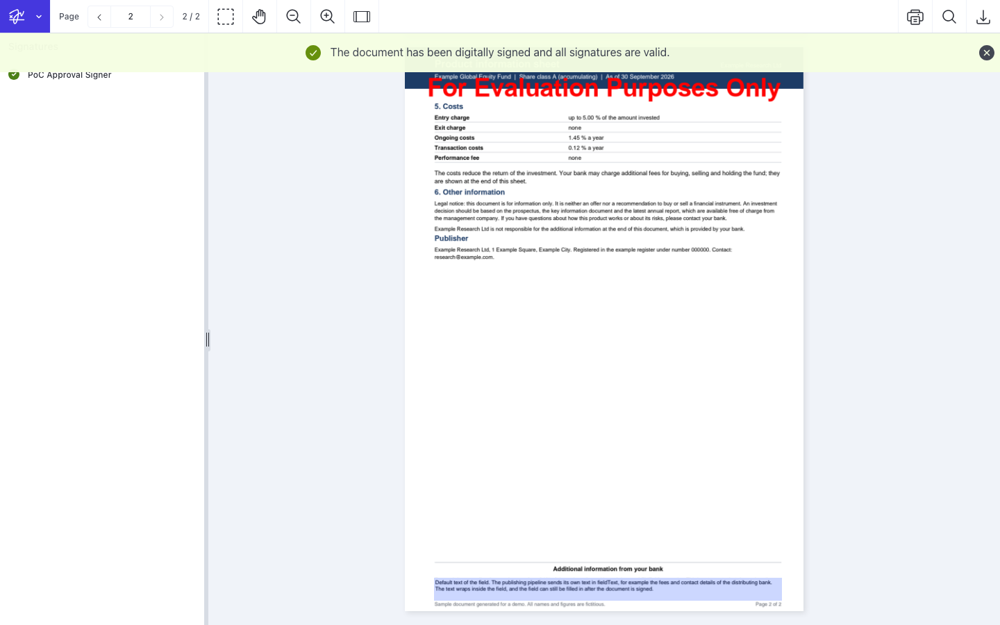
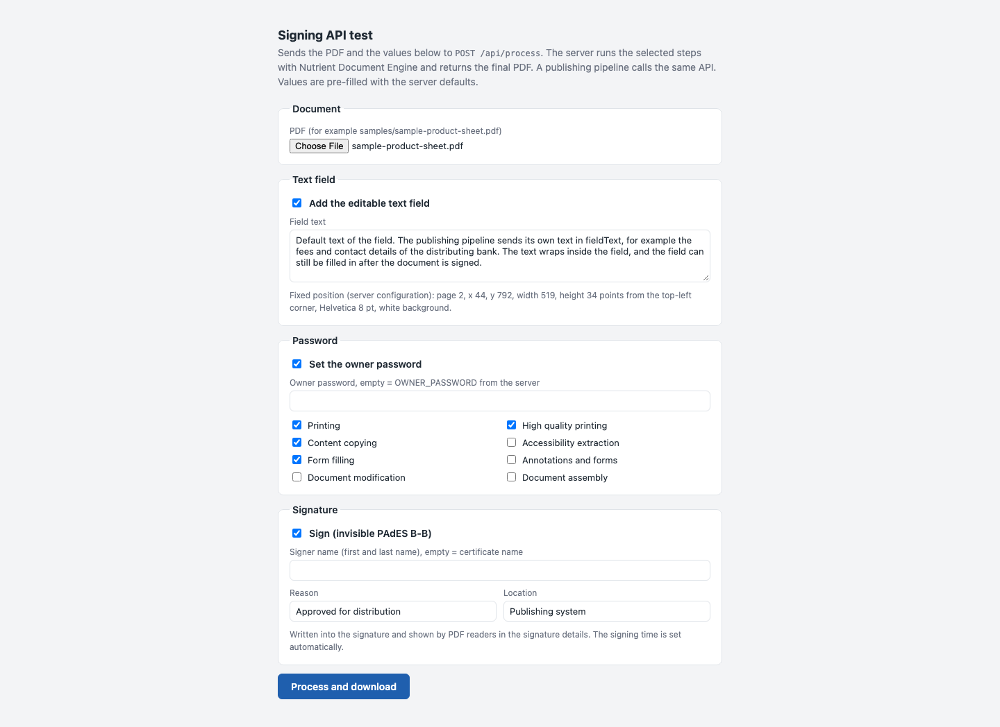
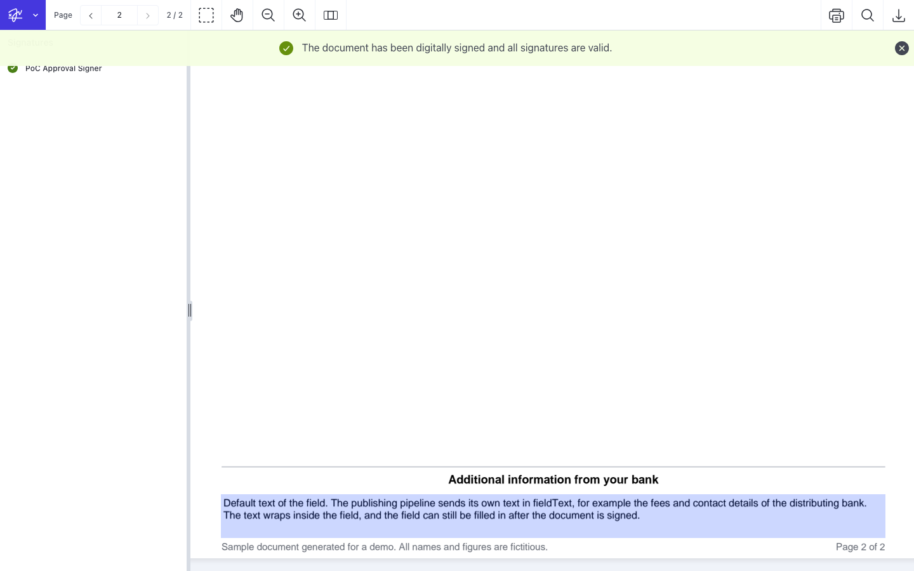

# Nutrient HSM Signing

A Nutrient.io demo that adds an editable text field to a PDF, protects it with an owner password and signs it with an invisible PAdES B-B signature whose key sits in an HSM, all server-side through one HTTP call.



A publishing system creates the PDF, then its pipeline calls `POST /api/process` on a backend that runs Nutrient Document Engine. Three switches select the steps, which always run in this order:

1. **Field.** Document Engine (`POST /api/build`, `applyInstantJson`) adds an editable multiline text field at a fixed place, for example over the "Additional information from your bank" text on page 2 of the sample. The field is white and borderless, so the page looks unchanged, but the text can now be edited.
2. **Password.** Document Engine (`POST /api/build`, `owner_password` and `user_permissions`) sets an owner password only, no password to open. Default permissions: printing, high quality printing, copying and form filling. Editing, comments and page changes are blocked. Encryption is AES-128.
3. **Sign.** Document Engine (`POST /api/sign`, CAdES, `b-b`, SHA-256, `signatureContainer: raw`) calls the signing service, which signs with a key in an HSM through PKCS#11, or with a `.p12` file. Only the data to be signed goes to the signing service, never the PDF. Document Engine builds the CMS container and appends it as an incremental update.

Everything runs locally in Docker. No cloud service is involved; SoftHSM stands in for the HSM.

| Service | Role |
|---|---|
| `db` | Postgres 16, used by Document Engine |
| `softhsm` | One-shot init container: test PKI, SoftHSM token, key import and a test `.p12` with the same key |
| `signing-service` | .NET 8, `POST /sign`, the Document Engine signing service contract (`get_certificates`, `sign`). Key source: PKCS#11 or `.p12` |
| `document-engine` | Nutrient Document Engine 1.19.0 (host port 5100, for debugging) |
| `backend` | .NET 8 minimal API, `POST /api/process` and a test form (host port 8090). Stateless |

## Prerequisites

- Docker with docker compose v2
- Internet access for the first build (Debian packages, .NET images, Document Engine image)
- Free host ports 8090 and 5100
- Optional: .NET SDK 8 to build the services outside Docker, Python 3 to regenerate the sample

## Environment variables

docker compose reads `.env`. Variables exported in the shell override it. `scripts/init-env.sh` creates `.env` from `.env.example` and fills every local secret with a random value. All secrets are local test values: keep them out of version control and use a secret store for anything shared.

| Variable | Purpose | Default |
|---|---|---|
| `PG_PASSWORD` | Postgres password | random (init-env.sh) |
| `DE_API_TOKEN` | Document Engine API token, also used by the backend | random (init-env.sh) |
| `DE_SECRET_KEY_BASE` | Document Engine secret key base (64+ characters) | random (init-env.sh) |
| `DE_ACTIVATION_KEY` | Document Engine activation key (online activation) | empty = evaluation mode |
| `DE_LICENSE_KEY` | Document Engine license key (offline) | empty = evaluation mode |
| `OWNER_PASSWORD` | Default owner password; a request can send its own | random (init-env.sh) |
| `PKCS11_TOKEN_LABEL` | SoftHSM token label (init only) | `poc-signing-token` |
| `PKCS11_KEY_LABEL` | `CKA_LABEL` of the private key in the HSM | `poc-approval-signer` |
| `PKCS11_PIN` | HSM user PIN | random (init-env.sh) |
| `PKCS11_SO_PIN` | SoftHSM security officer PIN (init only) | random (init-env.sh) |
| `SIGNING_P12_PATH` | `.p12` used by the signing service. Empty = HSM (PKCS#11) mode | `/p12/poc-signer.p12` |
| `SIGNING_P12_PASSWORD` | Password of the `.p12` (also used to create the test `.p12`) | random (init-env.sh) |

In evaluation mode Document Engine watermarks every output and adds revisions after the signature: use a license key to evaluate the signature itself. The Document Engine license needs the Document Editor, Form Creator, Annotations and Digital Signing components; setting the owner password needs no extra component.

Field layout, font and signature details are plain settings of the `backend` service in `docker-compose.yml`:

| Setting | Default |
|---|---|
| `FIELD_PAGE`, `FIELD_X`, `FIELD_Y`, `FIELD_WIDTH`, `FIELD_HEIGHT` | `2`, `44`, `792`, `519`, `34` (points, origin top-left of the page) |
| `FIELD_NAME` | `AdditionalInformation` |
| `FIELD_FONT`, `FIELD_FONT_SIZE` | `Helvetica`, `8` |
| `FIELD_TEXT` | Default text of the field |
| `PDF_PERMISSIONS` | `printing,print_high_quality,extract,fill_forms` |
| `SIGNER_NAME` | empty = common name of the signer certificate |
| `SIGNATURE_REASON`, `SIGNATURE_LOCATION` | `Approved for distribution`, `Publishing system` |

## Build and run

```bash
./scripts/init-env.sh
```

```bash
docker compose up -d --build
```

```bash
docker compose ps -a
```

`softhsm` shows "Exited (0)", the other services "Up". Check the signing key:

```bash
docker compose logs signing-service
```

Expect `Signing key from PKCS#12 file '/p12/poc-signer.p12' matches certificate 'CN=PoC Approval Signer, ...'`.

Open <http://localhost:8090> for the test form, or call the API:

```bash
curl -o result.pdf -F "file=@samples/sample-product-sheet.pdf;type=application/pdf" -F field=true -F password=true -F sign=true http://localhost:8090/api/process
```

Stop:

```bash
docker compose down
```

Full reset (the next start creates a new test PKI, token and `.p12`):

```bash
docker compose down -v
```

### Test certificates

`softhsm/init.sh` runs at every start and does nothing when everything exists. Otherwise it creates, with openssl:

- a test root CA "Nutrient PoC Test Root CA" (RSA 3072),
- a signer certificate "PoC Approval Signer" (RSA 2048, digitalSignature and nonRepudiation),
- a SoftHSM token with the signer key imported,
- `./p12/poc-signer.p12` with the same key and chain,

then deletes the key files. The certificates are in `./pki/root-ca.crt` and `./pki/signer.crt`. Both key sources therefore sign with the same throwaway certificate. `pki/` and `p12/` are generated at runtime and ignored by git.

### Sample

`samples/sample-product-sheet.pdf` is a fictitious two-page product sheet generated by `scripts/make-sample.py` with reportlab. The text under "Additional information from your bank" on page 2 sits exactly where the field goes by default. To generate it again, use a virtual environment outside the repository:

```bash
python3 -m venv /tmp/hsm-sample-venv
```

```bash
/tmp/hsm-sample-venv/bin/pip install reportlab
```

```bash
/tmp/hsm-sample-venv/bin/python scripts/make-sample.py
```

## Usage

1. Open <http://localhost:8090> and pick a PDF. The field text, permissions and signature details are pre-filled with the server defaults.
2. Choose the steps (field, password, sign), change the values if needed, then click **Process and download**.



The field stays editable after signing. It covers the original text with a white background:



The screenshots show the result opened in the Nutrient Web SDK viewer (evaluation mode, hence the watermark) with the test root CA trusted.

### Switch the key source

One value switches the signing service: `SIGNING_P12_PATH`.

- **`.p12` mode** (default): `SIGNING_P12_PATH=/p12/poc-signer.p12`. To use your own `.p12`, copy it to `./p12`, set `SIGNING_P12_PATH` and `SIGNING_P12_PASSWORD` in `.env`, then restart the signing service. The certificate with the private key is the signer; the other certificates in the file are the chain sent to Document Engine. RSA keys only.
- **HSM mode**: set `SIGNING_P12_PATH=` (empty) and restart the signing service. It loads the PKCS#11 library (`PKCS11_LIBRARY`, SoftHSM here), logs in with `PKCS11_PIN`, finds the private key by `CKA_LABEL` = `PKCS11_KEY_LABEL` and signs with `CKM_SHA256_RSA_PKCS`. The certificates are files (`SIGNER_CERTIFICATE_PATH`, `CA_CERTIFICATES_PATH`). `PKCS11_SLOT` is the index in the list of slots with a token.

```bash
docker compose up -d signing-service
```

In both modes the service signs a random probe at startup and checks it against the certificate, so a wrong key, password, PIN or label stops it with a clear log line.

### AWS CloudHSM

HSM mode works with the AWS CloudHSM PKCS#11 library without code changes. This was not tested here. See the [Nutrient guide](https://www.nutrient.io/guides/document-engine/signatures/integrations/aws-hsm/).

1. Run the signing service on a host in the CloudHSM cluster VPC (TCP 2223-2225 to the HSM ENIs).
2. Install the CloudHSM Client SDK 5 PKCS#11 library (`/opt/cloudhsm/lib/libcloudhsm_pkcs11.so`), put `customerCA.crt` in `/opt/cloudhsm/etc` and run `configure-pkcs11 -a <HSM IP>`. The signing service image is Debian 12: check that the library loads there.
3. Create a crypto user and an RSA key in the HSM with `sign=true`, a CSR with that key, and a certificate from your CA.
4. Set `SIGNING_P12_PATH=` (empty), `PKCS11_LIBRARY=/opt/cloudhsm/lib/libcloudhsm_pkcs11.so`, `PKCS11_SLOT=0`, `PKCS11_PIN=<crypto user>:<password>`, `PKCS11_KEY_LABEL=<label>`, mount the certificate files and `/opt/cloudhsm`.
5. The service opens one PKCS#11 session at startup: add a re-login after an HSM failover for production.

### Trusted signing provider

A test certificate is never trusted by other people's PDF readers: the root must be on the Adobe Approved Trust List (AATL) or the EU Trusted List. A qualified provider plugs into the signing service as a third key source, next to `.p12` and PKCS#11: the signing service sends the hash to the provider API (for example the Cloud Signature Consortium API `signatures/signHash`) and returns the raw signature. Document Engine and the backend do not change. If the provider issues short-lived certificates, use `cadesLevel` `b-lt` instead of `b-b` so the signature stays valid after the certificate expires. See the [GlobalSign integration guide](https://www.nutrient.io/guides/document-engine/signatures/integrations/globalsign/).

### Field editable after signing

A PDF signature covers the whole file as it is when signed. Editing the field later appends an incremental update after the signature. Because this is an approval signature without a lock (no DocMDP, no FieldMDP), filling an existing form field is a permitted change: validators report the signature as valid with form fill-in changes. Changing page content after signing makes the signature invalid. The owner password also blocks every change other than form filling.

### Adobe Acrobat with the test certificate

To see the signature as valid, trust the test root once: signature panel, right-click the signature, **Show Signature Properties**, **Show Signer's Certificate**, select "Nutrient PoC Test Root CA", **Trust**, **Add to Trusted Certificates**, tick **Use this certificate as a trusted root**, then **Validate All**. No password is asked when the PDF opens: it only has an owner password, which Acrobat asks for on a restricted action.

### Field font

The default font is Helvetica, which every PDF reader has. To use another font, copy the TTF or OTF file into `./fonts` (mounted as `/custom-fonts`), restart Document Engine and set `FIELD_FONT` to the name listed by `GET http://localhost:5100/api/fonts` (header `Authorization: Token token="<DE_API_TOKEN>"`). Document Engine writes the font name as given into the field `/DA`, so a name with a space produces an invalid `/DA`.

## API

| Method and path | Description |
|---|---|
| `POST /api/process` | multipart/form-data, see below. Returns the final PDF (`<name>-processed.pdf`) |
| `GET /api/defaults` | Server defaults: field text and position, permissions, signer name, reason, location |

`POST /api/process` fields. A switch is on with `true`, `on` or `1`. Any combination works; with no switch the PDF comes back unchanged.

| Field | Description |
|---|---|
| `file` | Required. The PDF |
| `field` | `true` = add the text field |
| `fieldText` | Text of the field. Default: `FIELD_TEXT`. Line breaks are kept |
| `password` | `true` = set the owner password |
| `ownerPassword` | Default: `OWNER_PASSWORD` |
| `permissions` | Comma-separated Document Engine `user_permissions`: `printing`, `print_high_quality`, `extract`, `extract_accessibility`, `fill_forms`, `annotations_and_forms`, `modification`, `assemble`. Default: `PDF_PERMISSIONS` |
| `sign` | `true` = sign |
| `signerName` | Signer name (`/Name`). Default: `SIGNER_NAME`, empty = certificate common name |
| `signatureReason` | Reason (`/Reason`). Default: `SIGNATURE_REASON` |
| `signatureLocation` | Location (`/Location`). Default: `SIGNATURE_LOCATION` |

Errors: HTTP 400 for a bad request, 502 with Document Engine's status and body. When the PDF was protected in the same request, the backend sends the owner password to `/api/sign` in the header `pspdfkit-pdf-password: base64:<password>`. The signed PDF stays encrypted.

## Known issues

- Font names with spaces are written unescaped into the field `/DA`.
- The permission value `/P` lacks the reserved bits that ISO 32000 requires (bits 7-8 and 13-32). Document Engine, Poppler and Acrobat open the files; some validators need a patch.
- Encryption is AES-128; AES-256 is not selectable through documented options.
- Instant JSON import rejects a widget without `opacity`, although the 1.19.0 OpenAPI spec marks it optional.

## Files

| Path | Content |
|---|---|
| `docker-compose.yml` | Services and settings (field layout, permissions) |
| `.env.example` | Every variable, empty or with a local default |
| `scripts/init-env.sh` | Creates `.env` with random local secrets |
| `scripts/make-sample.py` | Generates the sample PDF |
| `backend/` | `Program.cs` (`POST /api/process`), `wwwroot/index.html` (test form) |
| `signing-service/` | `Program.cs` (`POST /sign`, `.p12` or PKCS#11), `Pkcs11.cs` |
| `softhsm/` | `Dockerfile`, `init.sh` (test PKI, token, test `.p12`) |
| `samples/sample-product-sheet.pdf` | Fictitious sample |
| `fonts/` | Optional fonts for the field (empty) |
